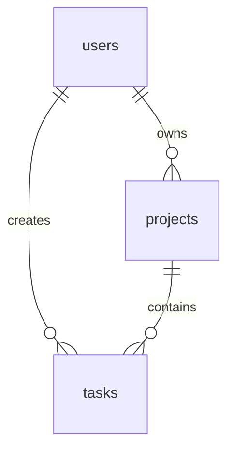

# Database Scheme

This project uses a small Laravel schema centered on users, projects, and tasks.

## Overview

## Tables

### `users`

Laravel's default authenticated users table. It is referenced by both `projects.user_id` and `tasks.user_id`.

### `projects`

Stores top-level project records.

| Column | Type | Nullable | Notes |
| --- | --- | --- | --- |
| `id` | bigint | no | Primary key |
| `title` | string | no | Project title |
| `user_id` | foreignId | no | References `users.id` |
| `created_at` | timestamp | no | Laravel timestamp |
| `updated_at` | timestamp | no | Laravel timestamp |

Relationships:

- `Project` belongs to `User`
- `Project` has many `Task` records

### `tasks`

Stores work items that belong to a project.

| Column | Type | Nullable | Notes |
| --- | --- | --- | --- |
| `id` | bigint | no | Primary key |
| `title` | string | no | Task title |
| `body` | longText | yes | Task description |
| `project_id` | foreignId | no | References `projects.id` |
| `completed` | boolean | no | Defaults to `false` |
| `user_id` | foreignId | no | References `users.id` |
| `created_at` | timestamp | no | Laravel timestamp |
| `updated_at` | timestamp | no | Laravel timestamp |

Relationships:

- `Task` belongs to `Project`
- `Task` belongs to `User`

## Constraints and behavior

- `tasks.project_id` cascades on delete, so removing a project removes its tasks.
- `tasks.body` is nullable, so tasks can exist without a description.
- The application exposes project-scoped task endpoints under `/api/projects/{project}/tasks`.

## Seeded data

The database seeder creates:

- 5 users
- 5 projects
- 20 tasks

Seeded project and task records are assigned to random users and projects.
